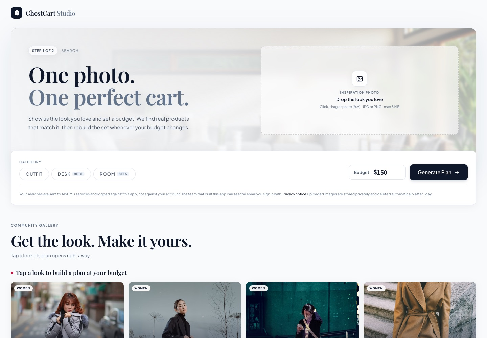
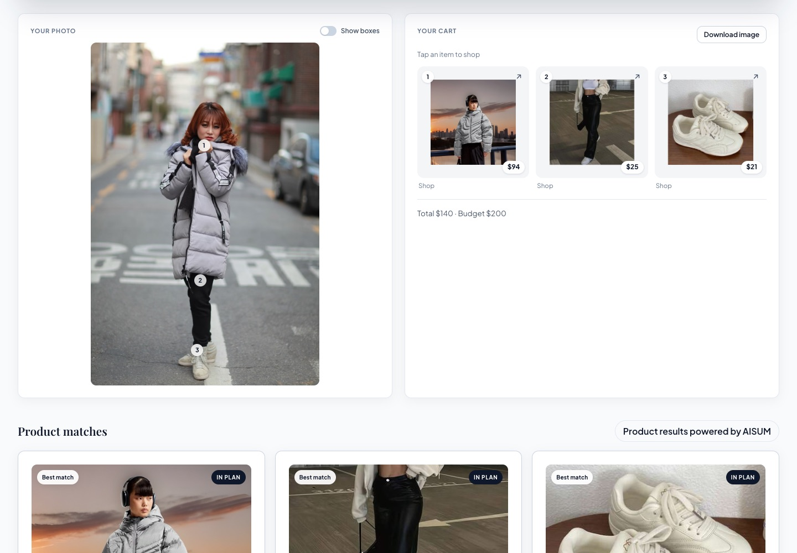

# GhostCart

**Upload one inspiration photo, set a budget, and GhostCart builds a cart of real products
that recreates the look, then rebuilds it whenever the budget changes.**

Live: <https://app-103901851610.us-central1.run.app/ghostcart> (requires a Google sign-in)

Built for the AISUM Agent Bowl '26 on top of AISUM's product-search tools.

## Features

- **Three categories.** Outfit uses AISUM image search, with no LLM calls and a
  12-second deadline. Desk and Room use DeepSeek to list the items in the photo, then
  AISUM text search.
- **The whole cart stays within budget.** An exact knapsack, computed in cents, picks
  one product per item. Change the budget or swap in one of three alternatives, and the
  rest of the cart is rebuilt without searching again.
- **Gallery.** Ready-made looks open instantly from a stored plan. Behind the scenes,
  GhostCart refreshes them with real AISUM searches, but only with capacity no user is
  waiting for.
- **Result photo.** Each Outfit cart item is numbered on the photo. Hover a product to
  see where it is, or turn on "Show boxes" to see every box.
- **Lookboard.** Download the photo and the cart as one image, with a QR code back to
  the app.
- **Little things:**
  - a first-visit tour,
  - the browser's Back / Forward buttons work,
  - a notice in in-app browsers, where Google sign-in is blocked,
  - an admin-only usage page.

| Home and gallery | Outfit result |
| --- | --- |
|  |  |

## Tech stack

| Part | Uses |
| --- | --- |
| Backend | Python 3.11, FastAPI, Uvicorn, httpx, Pillow, NumPy |
| Product search | AISUM MCP tools: `search_products_by_image`, `search_products_by_text` |
| LLM | DeepSeek through an OpenAI-compatible gateway (Desk / Room only) |
| Front end | Plain HTML / CSS / ES modules, driver.js (tour), Firebase Auth (Google sign-in) |
| Cloud | Cloud Run (one instance), Cloud Storage (uploads and gallery plans), Cloud Logging (usage stats) |
| Tests | pytest (offline), Node for the front-end pure functions |

## Architecture

[docs/architecture.md](docs/architecture.md) covers:

- the use cases,
- a system diagram,
- the modules,
- the data flows for planning, the gallery cache, the AISUM priority queue and stats,
- deployment,
- known limits.

## Run locally

You need Python 3.11, [uv](https://docs.astral.sh/uv/), an AISUM MCP key, an
OpenAI-compatible LLM key and a Firebase project with Google sign-in.

1. Copy the settings template, then fill in your own values. `.env` is ignored by git;
   never commit it.

   ```bash
   cp .env.example .env
   ```

2. Install the dependencies and start the server:

   ```bash
   uv venv --python 3.11 .venv
   uv pip install --python .venv/bin/python -r requirements.txt -r requirements-dev.txt
   .venv/bin/python -m uvicorn src.main:app --reload
   ```

3. Open <http://localhost:8000/ghostcart> by typing it into the address bar. Use
   `localhost`, not `127.0.0.1`, because Google sign-in only allows the listed domains.

Optional steps:

- Build the gallery plans into `scratch/local-store/`:

  ```bash
  .venv/bin/python scripts/precompute_gallery.py
  ```

- Run the tests (offline, with no AISUM or LLM calls):

  ```bash
  .venv/bin/python -m pytest tests
  ```

Two things work differently from Cloud Run:

- **Uploads.** A local server can't sign bucket URLs, so test with public image links.
- **The tour.** `?reset-tour` (local only) shows the tour again.

Windows commands and step-by-step checks are in [docs/setup.md](docs/setup.md).
Common errors are in [docs/troubleshooting.md](docs/troubleshooting.md).

## Deploy

GhostCart runs on Cloud Run, built from source. Cloud Run doesn't read `.env`, so first
copy the settings into `env.yaml`, which git also ignores:

```bash
grep -E '^[A-Z_]+=' .env | sed -E 's/^([A-Z_]+)=(.*)$/\1: "\2"/' > env.yaml
```

Then deploy:

```bash
gcloud run deploy app --source . --region us-central1 --allow-unauthenticated --env-vars-file env.yaml --max-instances=1
```

Keep `--max-instances=1`. The limiter that keeps AISUM calls within the team's limits
counts per process ([why](docs/architecture.md#54-aisum-priority-queue)). After the first
deploy, `gcloud run deploy app --source . --region us-central1` keeps the existing
environment variables.

The service account also needs access to the upload bucket and permission to sign URLs,
as listed in [docs/architecture.md § Deployment](docs/architecture.md#6-deployment). The
full walkthrough is in [docs/deploy.md](docs/deploy.md).

## Credits

- **[AISUM](https://aisum-agent-bowl.web.app/)** provides every product, price, image and
  shop link, through its product-search tools. Thanks to the AISUM team for the tools,
  the starter kit this project grew from, and the Agent Bowl.
- **DeepSeek** (via the event's LLM gateway) splits Desk and Room photos into items and
  checks product types.

### Images

- **Gallery photos.** They come from [Unsplash](https://unsplash.com) (Desk, Room and
  some Outfit looks) and [Pexels](https://www.pexels.com) (most Outfit looks). They are
  used under the [Unsplash License](https://unsplash.com/license) and the
  [Pexels License](https://www.pexels.com/license/), and are loaded from those sites'
  CDNs; this repository contains no copies.
- **Credits.** Each photographer is credited in [static/gallery.json](static/gallery.json)
  (`credit.name`, `credit.url`, `credit.page`), and the site links to both licences.
- **Product images.** They belong to their retailers and are shown as AISUM returns them.
- **Screenshots** in `docs/images/` are of this app. They contain a gallery photo by
  거열 박 on [Pexels](https://www.pexels.com/photo/portrait-of-a-woman-standing-on-a-street-7600411/)
  and product images from AISUM results.

### Third-party code

| Library | Licence | How it is used |
| --- | --- | --- |
| [driver.js](https://github.com/nilbuild/driver.js) 1.14.0 | MIT | Bundled in `static/vendor/`; the licence text is in [static/vendor/LICENSES.txt](static/vendor/LICENSES.txt) |
| Firebase JS SDK 12.4.0 | Apache-2.0 | Loaded from gstatic.com |
| Google Fonts: Playfair Display, Plus Jakarta Sans | SIL OFL 1.1 | Loaded from fonts.googleapis.com |
| FastAPI, Uvicorn, httpx, Pydantic, PyJWT, Pillow, NumPy, google-cloud-storage | MIT / BSD / Apache-2.0 / HPND | Python packages from `requirements.txt` |
| segno, zxing-cpp | BSD-3-Clause / Apache-2.0 | Dev only: making and checking the Lookboard QR code |
