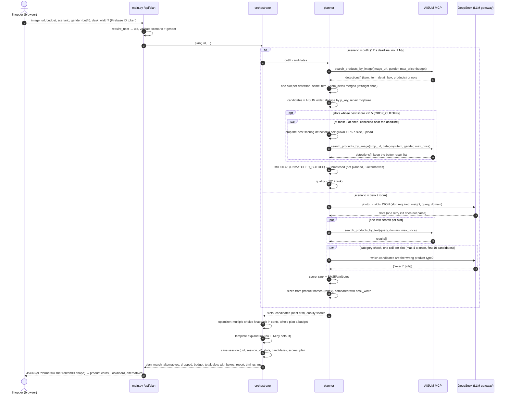
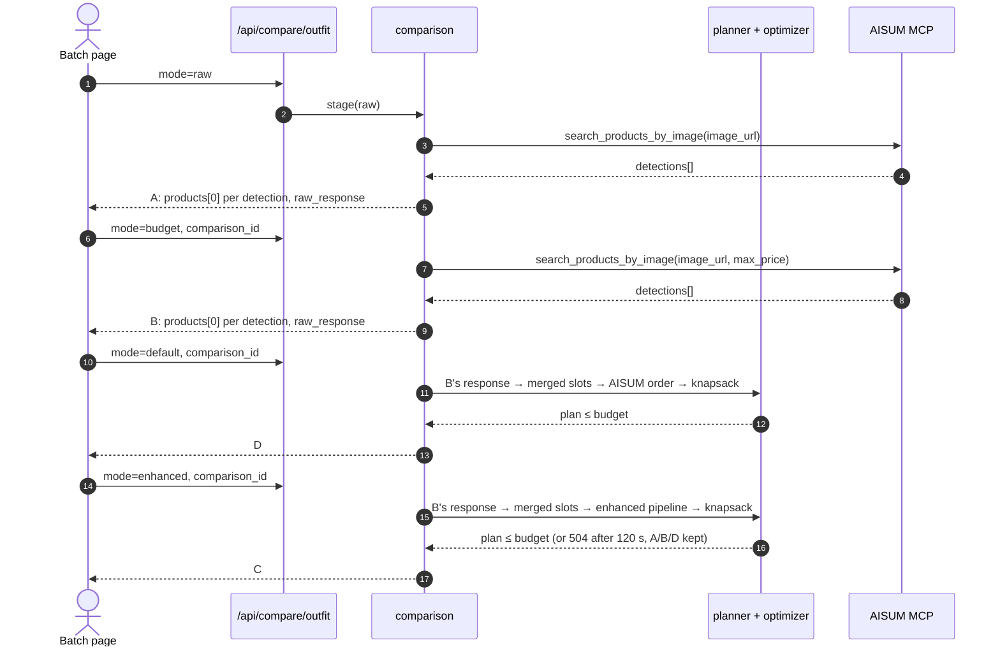
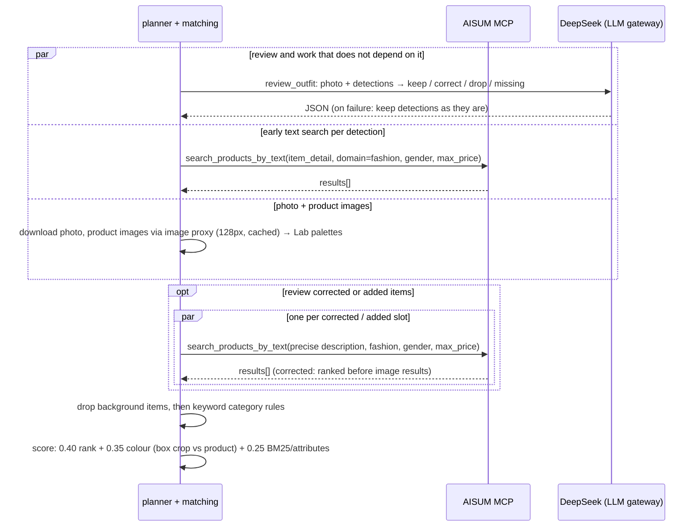
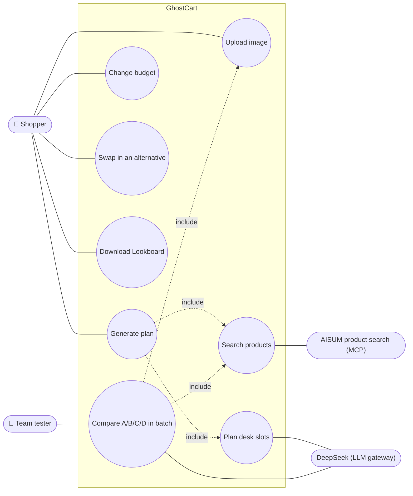

# GhostCart architecture

How one plan is made, and what a shopper can do with it. Code: `src/main.py` (routes),
`src/agent/orchestrator.py` (the flow), `src/agent/planner.py` (slots and search),
`src/agent/optimizer.py` (budget knapsack), `src/agent/comparison.py` (A/B/C/D test
groups), `src/agent/matching.py` (colour and text matching, used only by the
experimental pipeline).

## `POST /api/plan` (default path)

The user always picks `scenario` (`outfit`, `desk` or `room`); nothing is
auto-detected. An outfit also needs the user's `gender` (`F`, `M` or `UNISEX`).

The outfit path (`src/agent/outfit.py`) makes **no model calls** and has a 12-second
deadline: one image search, a crop re-search for weak items, unmatched items set aside,
then the knapsack. The explanation is a factual template (`GENERATE_EXPLANATIONS =
False` in `orchestrator.py`; set it to `True` for the old LLM explanation).

`/api/replan` reuses the saved candidates: no search, only the knapsack again.
`pin: {slot: p_key}` forces that product into its slot and the optimizer spends the
rest of the budget on the other slots.

## Comparison groups (`/ghostcart/batch`, `POST /api/compare/outfit`)

Outfit only. One request per group (`mode`), so a slow or failed group never erases
the earlier ones. The page runs A → B → D → C (C is slowest and can time out) and
shows A/B/C/D.

| Group | `mode` | Image search | Picks | Whole-outfit budget | Left/right shoe | LLM |
| --- | --- | --- | --- | --- | --- | --- |
| A | `raw` | no filters | literal `products[0]` per detection | not enforced | kept apart | none |
| B | `budget` | `max_price=budget` (per item) | literal `products[0]` per detection | not enforced | kept apart | none |
| C | `enhanced` | reuses B's response | old experimental pipeline (below) | knapsack | merged | 1 review call |
| D | `default` | reuses B's response | AISUM order (the default path without crop re-search / unmatched) | knapsack | merged | none |

B's `max_price` caps each item, not the outfit; D is B plus the whole-outfit
knapsack. It equals `/api/plan` with the score cutoff set to 0.
C and D search again (with `gender`) only when the user chose a gender; A and B never
send it. Their `timings_ms.including_reused_search` adds B's search time.

### Experimental pipeline (group C only)

`planner.outfit_candidates(..., enhanced=True)`. Not the default.

## Use cases

Mermaid has no use-case diagram type; this flowchart draws one: actors on the sides,
use cases in the middle, `include` where one use case always runs another.

| Use case | Route | External calls |
| --- | --- | --- |
| Upload image | `POST /api/upload` | Cloud Storage (private, signed URL 60 min, deleted after 1 day) |
| Generate plan | `POST /api/plan` | outfit: AISUM image search (+ crop searches), Cloud Storage for crops; desk / room: DeepSeek (slots, category checks) and AISUM text search |
| Change budget | `POST /api/replan` `{budget}` | none by default |
| Swap in an alternative | `POST /api/replan` `{pin: {slot: p_key}}` | none by default |
| Download Lookboard | `GET /api/lookboard-image` per image, canvas → PNG in the browser | the product image hosts, through the server |
| Compare A/B/C/D | `POST /api/compare/outfit` per group, `GET /api/comparison-image` for the PNG | AISUM image search (A, B; C/D only with gender); C also AISUM text search and one DeepSeek review |
