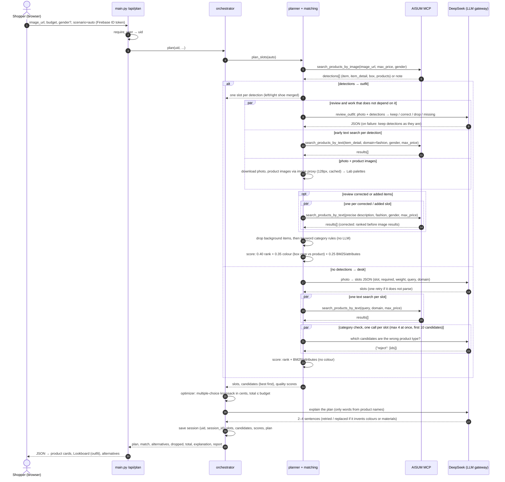
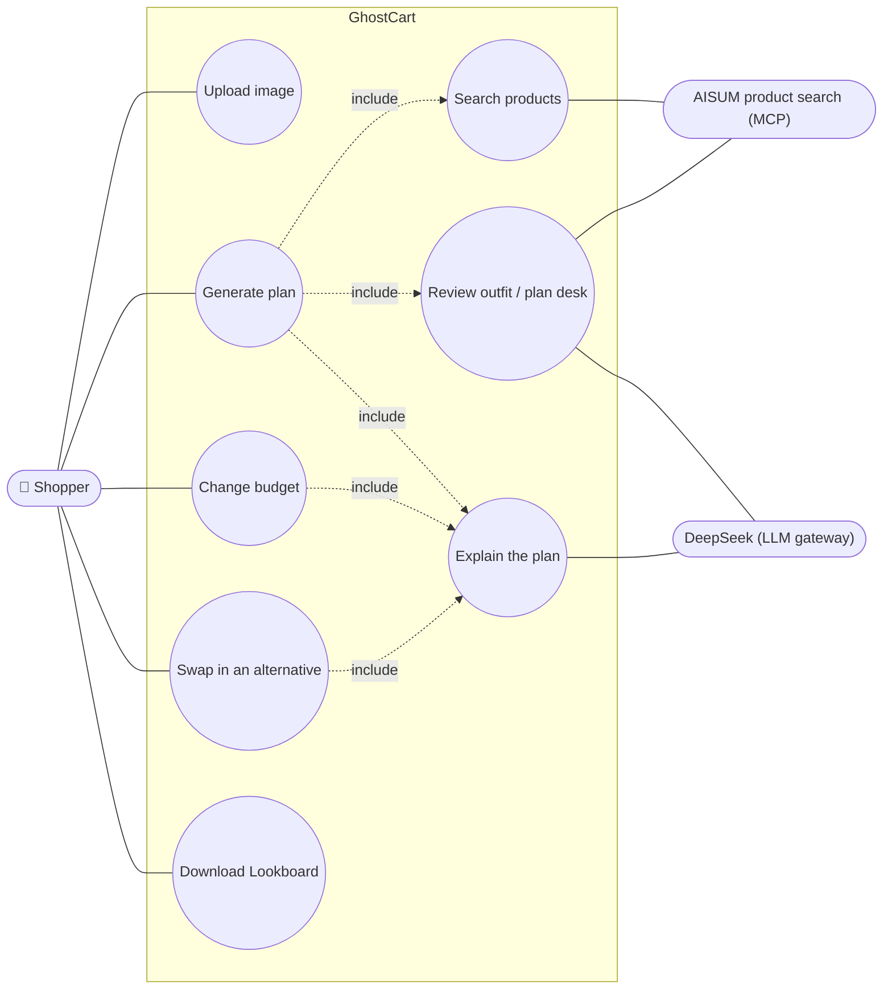

# GhostCart architecture

How one plan is made, and what a shopper can do with it. Code: `src/main.py` (routes),
`src/agent/orchestrator.py` (the flow), `src/agent/planner.py` (slots and search),
`src/agent/matching.py` (colour and text matching, no LLM), `src/agent/optimizer.py`
(budget knapsack).

## `POST /api/plan`

`scenario` defaults to `auto`: image search runs first and decides. Detections mean an
outfit; none (the tool returns a `note`) means a desk, planned by DeepSeek.

`/api/replan` reuses the saved candidates: no search, no review, one explanation call.
`pin: {slot: p_key}` forces that product into its slot and the optimizer spends the
rest of the budget on the other slots.

## Use cases

Mermaid has no use-case diagram type; this flowchart draws one: actors on the sides,
use cases in the middle, `include` where one use case always runs another.

| Use case | Route | External calls |
| --- | --- | --- |
| Upload image | `POST /api/upload` | Cloud Storage (public for 1 day) |
| Generate plan | `POST /api/plan` | AISUM image + text search; DeepSeek: outfit review or desk slots, desk category checks, explanation |
| Change budget | `POST /api/replan` `{budget}` | DeepSeek: explanation |
| Swap in an alternative | `POST /api/replan` `{pin: {slot: p_key}}` | DeepSeek: explanation |
| Download Lookboard | `GET /api/lookboard-image` per image, canvas → PNG in the browser | the product image hosts, through the server |
