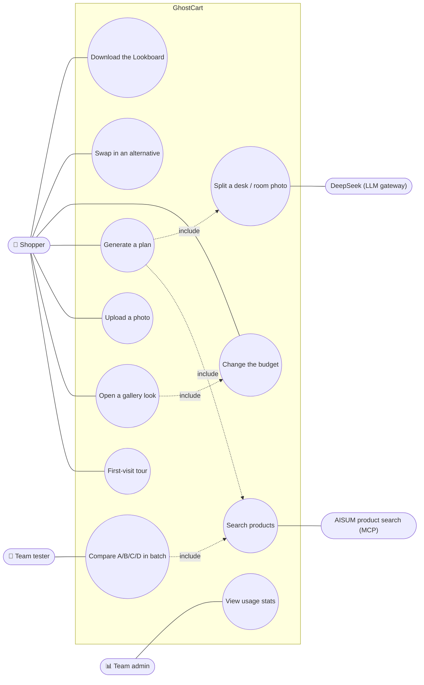
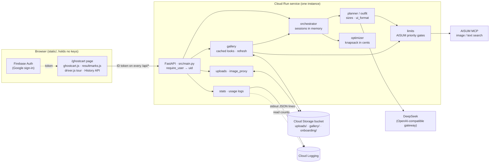

# GhostCart architecture

1. [Overview](#1-overview)
2. [Use cases](#2-use-cases)
3. [System architecture](#3-system-architecture)
4. [Modules](#4-modules)
5. [Data flows](#5-data-flows)
6. [Deployment](#6-deployment)
7. [Limits and next steps](#7-limits-and-next-steps)

## 1. Overview

GhostCart turns one inspiration photo and a budget into a shopping cart of real
products. The user picks a category (Outfit, Desk or Room) and uploads a photo, or opens
a look from the gallery. GhostCart then:

- finds matching products with AISUM's product-search tools,
- picks one product per item so that the **whole cart** stays within the budget,
- rebuilds the cart right away when the budget changes or the user swaps in an
  alternative.

Some rules hold throughout:

- **Prices and links come only from AISUM.** The model never writes a price, a product
  name or a link. Each product card opens AISUM's `click_url` unchanged.
- **A deterministic algorithm picks the products.** A multiple-choice knapsack, computed
  exactly in cents, does the selection. The LLM never decides which product wins.
- **Outfit makes no LLM calls.** It uses image search only and has a 12-second deadline.
  Desk and Room call DeepSeek twice: once to split the photo into a list of items, and
  once per item to check the product type.
- **Unknown facts stay unknown.** AISUM has no dimensions, stock or sizing data. Desk
  sizes are read from product names only, and anything that can't be read is marked
  "unverified", never claimed.

## 2. Use cases

Mermaid has no use-case diagram, so this is drawn as a flowchart: actors on the sides,
use cases in the middle, and `include` where one use case always runs another.



| Use case | Route | External calls |
| --- | --- | --- |
| First-visit tour | `GET` / `POST /api/me/onboarding` | Cloud Storage (one small object per account) |
| Open a gallery look | `POST /api/gallery/{look_id}/open` | none when cached; a background AISUM refresh afterwards ([5.3](#53-gallery-cached-looks-and-background-refresh)) |
| Upload a photo | `POST /api/upload` | Cloud Storage (private; signed URL valid for 60 min; deleted after 1 day) |
| Generate a plan | `POST /api/plan` | Outfit: AISUM image search, plus crop searches. Desk / Room: DeepSeek, then AISUM text search |
| Change the budget | `POST /api/replan` `{budget}` | none |
| Swap in an alternative | `POST /api/replan` `{pin: {slot: p_key}}` | none |
| Download the Lookboard | `GET /api/lookboard-image` per product image; the browser draws the PNG on a canvas | product image hosts, through the server |
| Compare A/B/C/D | `POST /api/compare/outfit`, once per group | AISUM image search; group C also uses text search and one DeepSeek call |
| View usage stats | `GET /admin/stats`, `GET /api/admin/stats` | Firebase Auth user list and Cloud Logging, read-only |

## 3. System architecture



- The browser only ever talks to our server. Every `/api/*` request carries the user's
  Firebase ID token, and `src/auth.py` checks it and turns it into a `uid`.
- AISUM calls and LLM calls happen server-side, using keys from environment variables.
- Plans are held in memory, keyed by `(uid, session_id)`, at most 20 per user. Anything
  that must survive a restart (gallery looks, whether the tour was seen) lives in the
  bucket.

## 4. Modules

| File | What it does |
| --- | --- |
| `src/main.py` | Every route. Pages accept GET and HEAD. `/api/*` routes require sign-in. |
| `src/auth.py` | Verifies the Firebase ID token and returns the uid. |
| `src/agent/orchestrator.py` | Runs `plan` and `replan`, keeps the session store, and builds the template explanation. |
| `src/agent/outfit.py` | The Outfit path: image search, merging left and right shoes, crop re-search, unmatched items, all within a 12-second deadline. |
| `src/agent/planner.py` | Desk / Room: DeepSeek splits the photo into slots, then text search and a per-slot category check. Also the thin AISUM adapters `search_image` / `search_text`. |
| `src/agent/optimizer.py` | Multiple-choice knapsack in exact cents. quality = 1/(1+rank). Skips products with no price and "Renewed" products. |
| `src/agent/sizes.py` | Reads sizes from product names with a regex and flags `too_large` / `size_unverified` against the desk width. |
| `src/agent/limits.py` | Caps AISUM calls at once and lets users go ahead of background work ([5.4](#54-aisum-priority-queue)). |
| `src/agent/ui_format.py` | The `?format=ui` response shape that the page reads. |
| `src/agent/comparison.py`, `matching.py` | The A/B/C/D comparison groups and the older experimental pipeline (group C only). |
| `src/gallery.py` | Gallery catalogue, stored looks (bucket or a local folder), and background refresh. |
| `src/uploads.py` | Uploads to the private bucket and signs V4 URLs through IAM signBlob, so no key file is needed. |
| `src/image_proxy.py` | Proxies product images for the Lookboard and comparison PNGs. It only serves URLs already in the user's own session, and only public https URLs. |
| `src/usage.py`, `src/stats.py` | Structured log lines, and the aggregates behind `/admin/stats`. |
| `static/ghostcart.js` | The main page: category picker, upload, gallery grid, result view, Lookboard, tour, history. |
| `static/resultmarks.js` | Pure functions that turn detection boxes into numbered markers (Node tests). |
| `static/gallery.json` | The gallery looks: photo ID, source, photographer credit, category, budget. |
| `scripts/precompute_gallery.py` | Builds and stores every gallery look's plan. |

## 5. Data flows

### 5.1 `POST /api/plan`

The user always picks `scenario` (`outfit`, `desk` or `room`); nothing is
auto-detected. Outfit also needs `gender` (`F`, `M` or `UNISEX`), because the model
never guesses it.

```mermaid
sequenceDiagram
    autonumber
    actor U as Shopper (browser)
    participant API as main.py /api/plan
    participant O as orchestrator
    participant P as planner / outfit
    participant G as limits (AISUM gates)
    participant A as AISUM MCP
    participant D as DeepSeek

    U->>API: image_url, budget, scenario, gender (outfit), desk_width? + ID token
    API->>API: require_user → uid · cancel this user's gallery refresh
    API->>O: plan(uid, ...)

    alt scenario = outfit (12 s deadline, no LLM)
        P->>G: wait for an image-search slot (users first)
        P->>A: search_products_by_image(image_url, gender, max_price=budget)
        A-->>P: detections[] (item, item_detail, box, products)
        P->>P: one slot per detection; same item + item_detail merged (left/right shoe)
        opt slots whose best score < 0.5
            par up to 3 at once, cancelled near the deadline
                P->>P: crop the best detection's box (+10 % each side), upload
                P->>A: search_products_by_image(crop, category=item, gender, max_price)
                A-->>P: keep whichever result list scores higher
            end
        end
        P->>P: still < 0.45 → unmatched (not in the cart, 3 alternatives shown)
    else scenario = desk / room
        P->>D: photo → slots JSON (slot, required, weight, query, domain)
        par one text search per slot
            P->>A: search_products_by_text(query, domain, max_price)
        end
        par one category check per slot (4 at once)
            P->>D: which candidates are the wrong product type?
        end
        P->>P: sizes from product names, compared with the desk width
    end

    O->>O: knapsack: the whole cart ≤ budget
    O->>O: save the session (uid, session_id)
    O-->>U: plan, alternatives, dropped, slots + boxes (?format=ui for the page)
    API->>API: one structured log line (event ghostcart_plan, no email)
```

### 5.2 `POST /api/replan`

Replan reuses the saved candidates, so there is no search and no LLM call; it only
re-runs the knapsack.

- `budget` re-optimises for the new budget.
- `pin: {slot: p_key}` forces that product into its slot and spends the rest of the
  budget on the other slots.
- An unmatched Outfit slot comes back into the cart when one of its alternatives is
  pinned.

### 5.3 Gallery: cached looks and background refresh

Every gallery look has a stored plan: the whole session, with slots, candidates and
scores. Opening a look is therefore a `replan` on stored data and returns in about a
second, with no AISUM call while the user waits.

```mermaid
sequenceDiagram
    autonumber
    actor U as Shopper
    participant API as /api/gallery/{look}/open
    participant Gal as gallery
    participant S as Bucket gallery/<look>/<ms>.json
    participant O as orchestrator
    participant A as AISUM (background, spare slots only)

    U->>API: open look
    API->>Gal: open_look(uid, look)
    Gal->>S: newest stored plan
    alt nothing stored yet
        Gal->>O: full live plan (the user waits), then store it
    end
    Gal->>O: copy into a new session for this user → replan
    O-->>U: cart (instant)
    opt not refreshed in the last 10 min and no other refresh running
        Gal-)A: background refresh (Outfit: full plan; Desk/Room: text searches only)
        A--)Gal: new candidates
        Gal-)S: write a new object (create-only), for the next viewer
    end
```

- **Precompute.** `scripts/precompute_gallery.py --store bucket --force` builds every
  look with the full pipeline, including the DeepSeek steps for Desk / Room. A full run
  makes about 150 AISUM calls and costs about $0.15 of LLM credit.
- **Refresh.**
  - It never changes what the current user sees; it only updates the stored plan.
  - There is at most one refresh per look every 10 minutes, and only one runs at a time.
  - A user's own `/api/plan` or `/api/upload` cancels that user's running refresh.
  - A Desk / Room refresh only keeps products that already passed the category check, so
    it needs no LLM call.
- **Storage is create-only.** Each refresh writes a new
  `gallery/<look_id>/<epoch_ms>.json` and the newest one wins. The service account
  needs only create and read access, never overwrite or delete.
- **Logging.** Gallery events are logged as `ghostcart_gallery`, apart from users' own
  searches, with the triggers `gallery_view`, `gallery_live`, `gallery_refresh` and
  `precompute`.

### 5.4 AISUM priority queue

AISUM's limits are per team: 3 image searches at once and 8 text searches at once. Going
over returns `RATE_LIMITED`. One Outfit plan can already need 3 image searches together
(the crop re-searches), so two users at once could exceed the limit.

`src/agent/limits.py` puts every AISUM search behind a gate for its tool:

- **A user's search waits in line** for a free slot. Waiters are served in order.
- **Background work** (gallery refresh, precompute) only takes a slot that is free
  *right now* and that no user is waiting for. Otherwise it raises `Busy`, and the
  refresh is dropped rather than half-stored. It never waits in front of a user.

The gates count calls within a single process. That is why Cloud Run runs with
`--max-instances=1`: with one instance, the gate sees the team's whole traffic, so the
per-team limit holds. Each instance handles many requests concurrently (async I/O), and
one instance is enough for the current traffic.

### 5.5 Page behaviour

- **Category first.** The home page shows the Outfit gallery. Desk / Room galleries
  appear only after the user picks that category.
- **First-visit tour** (driver.js 1.14.0, bundled in `static/vendor/`). It has 3 steps on
  desktop and 2 on phones, and each account sees it once: finishing or skipping it
  writes `onboarding/<uid>`. `?reset-tour` resets it, but only on a local server; on
  Cloud Run the DELETE route returns 404.
- **Browser Back / Forward.**
  - The category, an open look and the result view are history entries (`?category=`,
    `?look=`, `?view=result`).
  - Back restores the previous screen and its scroll position, with
    `history.scrollRestoration = 'manual'`.
  - Restoring a look does not start another refresh.
- **Result photo.**
  - **Outfit:** every cart item gets a numbered dot on the photo, at the top centre of
    its box. Hovering a card highlights that item, and "Show boxes" shows every box.
  - **Desk / Room:** no position marks at all. Their slots come from the LLM's item
    list, not from detection boxes, so no dots, numbers or "Show boxes" switch are shown.
- **Lookboard.** This is a 1200-px-wide PNG drawn in the browser. Its footer carries a QR
  code (`static/ghostcart-qr.svg`) that links to the public `/ghostcart` page.
  `tests/test_lookboard_qr.py` checks that the QR decodes, both from the original and
  from a JPEG saved at quality 60.
- **In-app browsers** (WeChat, Instagram and others) block Google sign-in, so
  `static/inapp.js` shows a "open in your browser" notice there.

### 5.6 Usage stats and structured logs

- **Log lines.** Each `/api/plan` call writes one JSON line to stdout, which Cloud Run
  stores as a structured log entry. The line has: `event: ghostcart_plan`, uid,
  scenario, status, time and `excluded`. It has no email and no name.
- **`/admin/stats`** shows sign-ups, users per day, returning users and searches per
  day.
  - It reads the Firebase Auth user list and those log lines with the service
    account's read-only credentials.
  - It shows only aggregates, and caches them for 10 minutes.
  - It is visible only to the accounts listed in an environment variable. For everyone
    else, both the page and its API return 404.
- **Failures.** If a data source can't be read, the page says so instead of showing
  zero. A line `event: admin_stats_source_error` also goes to the log, with any emails
  masked.

### 5.7 Comparison groups (`/ghostcart/batch`, team testing)

This page is for Outfit only. It sends one request per group (`mode`), so a slow or
failed group never erases the ones before it.

| Group | `mode` | Image search | Picks | Whole-cart budget | LLM |
| --- | --- | --- | --- | --- | --- |
| A | `raw` | no filters | `products[0]` for each detection | not enforced | none |
| B | `budget` | `max_price=budget` (applies per item) | `products[0]` for each detection | not enforced | none |
| C | `enhanced` | reuses B's response | the older experimental pipeline (review, colour and BM25 re-rank) | knapsack | 1 review call |
| D | `default` | reuses B's response | AISUM order, without crop re-search | knapsack | none |

## 6. Deployment

- **Runtime.** Python 3.11 with FastAPI and Uvicorn, deployed with
  `gcloud run deploy --source .` (the steps are in [deploy.md](deploy.md)). Region:
  us-central1.
- **Instances.** `--max-instances=1`, for the reason in
  [5.4](#54-aisum-priority-queue).
- **Configuration.** Everything comes from environment variables, set from an
  `env.yaml` that git ignores. That covers the AISUM MCP URL and key, the LLM gateway
  URL, key and model, the Firebase web config, the upload bucket and the stats access
  list. Later deploys without env flags keep the existing variables.
- **Service account.** It needs:
  - create and read on the bucket,
  - `iam.serviceAccountTokenCreator` on itself (to sign upload URLs),
  - read access to the Firebase Auth user list and to Cloud Logging (for the stats
    page).
- **Bucket lifecycle rules:**

  | Prefix | Deleted after | Why |
  | --- | --- | --- |
  | `uploads/` | 1 day | user photos and crops: only kept while a plan is being made |
  | `gallery/` | 30 days | old snapshots of a look; refreshes keep writing new ones |
  | `onboarding/` | never | one tiny marker per account, so the tour is not shown again |

- **Rollback.** Every deploy is a Cloud Run revision. To roll back, send traffic to the
  previous one:
  `gcloud run services update-traffic app --region us-central1 --to-revisions=<previous-revision>=100`.
- **Tests.** `.venv/bin/python -m pytest tests` runs offline, with no AISUM or LLM calls.
  `static/resultmarks.js` and the module parse check use Node.

## 7. Limits and next steps

Known limits:

- **One instance.** This is the simplest way to keep within AISUM's per-team limits. To
  scale out, the gates would have to move to a shared store, such as Firestore or
  Redis.
- **In-memory sessions.** A restart or a new revision drops open plans. The user just
  generates the plan again, and gallery looks are unaffected because they are stored in
  the bucket.
- **No product facts beyond the name.** AISUM gives no size, stock, material or
  compatibility data. Desk widths are only regex reads of product names, and anything
  unreadable is marked unverified.
- **Outfit only for image search.** AISUM image search covers fashion only, so Desk and
  Room depend on DeepSeek's item list. They are slower (about 30–50 s), and the item
  list is sometimes wrong.
- **Match quality.** Patterns (stripes, houndstooth) and light colours under warm light
  are still often missed. A crop search's score isn't fully comparable with the
  full-photo score, because a cropped item fills more of the image.
- **Local runs.** A bucket signed URL needs Cloud Run's identity, so a local server
  can't sign one. Locally, test with public image links instead.

Next steps:

- Move sessions and the AISUM gates to Firestore, so more than one instance can run.
- Make a missing pattern a hard filter when the item description names one (for
  example, striped).
- Grow the gallery, and let users publish their own looks with consent.
- Use scene match for Room once its scores can be used for ranking (today they are all
  above 0.97).
